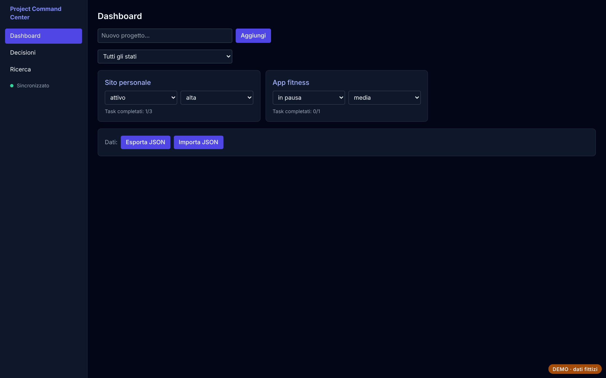
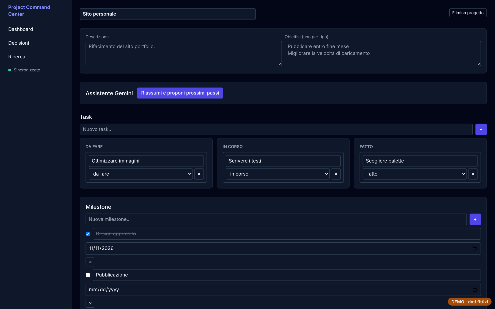
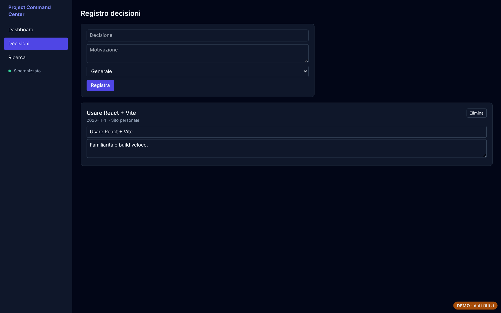
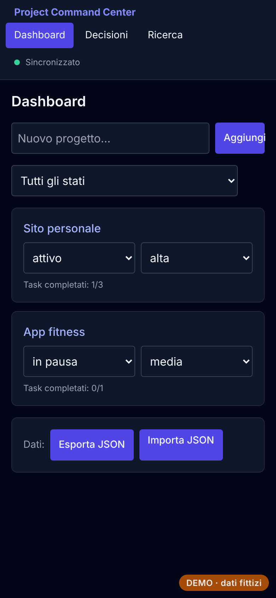

# Project Command Center

Centro di controllo dei progetti personali: obiettivi, milestone, task, note e registro delle decisioni, con ricerca trasversale.

**[Prova la demo](https://andreapollastrelli95.github.io/project-command-center-demo/)** · dati fittizi, salvati solo nel tuo browser; nella demo l'assistente AI è disattivato.



## Cosa fa

- **Progetti** con stato, priorità e obiettivi; avanzamento calcolato dai task completati.
- **Milestone, task e note** per ogni progetto, con titoli modificabili e conferma prima di eliminare.
- **Registro delle decisioni** con motivazione e data.
- **Sincronizzazione fine** tra dispositivi: le modifiche fatte in parallelo vengono unite riga per riga, senza perdite.
- **Ricerca** su tutti i contenuti, **esportazione/importazione** JSON validata.

| Progetto | Decisioni | Telefono |
|---|---|---|
|  |  |  |

## Come è fatto

React, TypeScript, Vite, Tailwind CSS, Dexie (IndexedDB), React Router; server Node per la sincronizzazione; Electron per la versione desktop.

I dati vivono nel browser (IndexedDB) e vengono sincronizzati con un archivio centrale tramite `/api/data`, con controllo di versione per non sovrascrivere le modifiche fatte da un altro dispositivo. Nella demo `public/demo-api.js` sostituisce il server con un archivio locale che segue le stesse regole.

## Avviarlo in locale

```bash
npm install
npm run dev      # sviluppo
npm run build    # versione web in dist/
```

---

Progetto di [Andrea Pollastrelli](https://andreapollastrelli95.github.io/).
